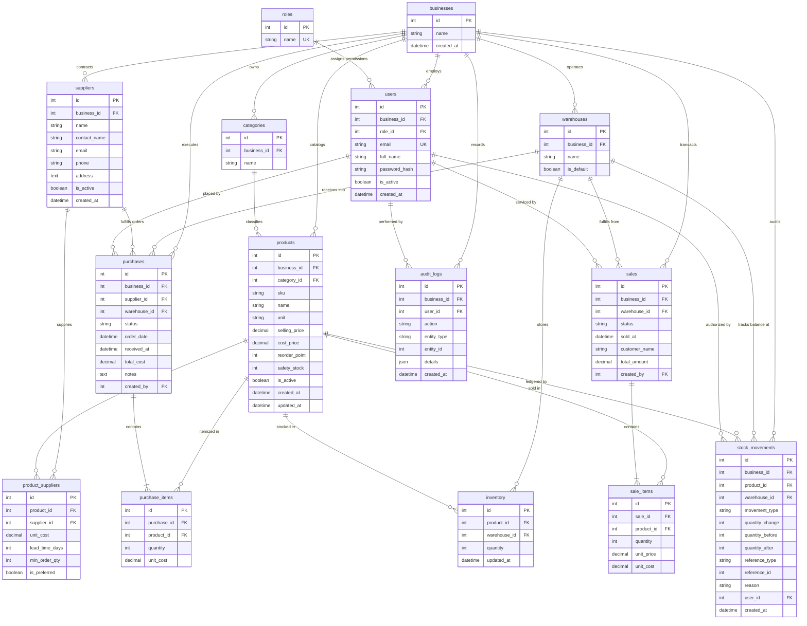

# StockIQ Relational Database Documentation

## 1. Entity-Relationship Diagram (ERD)

The StockIQ data model is fully normalized (3NF) with deliberate point-in-time financial snapshots. Multi-tenancy is native via `business_id` across every tenant-owned table.



---

## 2. Data Dictionary

> **Dialect note.** The column tables below use the original MySQL 8 type names.
> The PostgreSQL equivalent in `db/postgresql/schema.sql` keeps identical names,
> relationships, data semantics and all 15 primary keys / 13 CHECKs / 8 UNIQUEs /
> 28 foreign keys / 27 secondary indexes. Type mappings:
>
> | MySQL | PostgreSQL |
> | --- | --- |
> | `INT AUTO_INCREMENT` | `INTEGER GENERATED BY DEFAULT AS IDENTITY` |
> | `TINYINT(1)` | `BOOLEAN` |
> | `DATETIME` | `TIMESTAMP WITHOUT TIME ZONE` |
> | `DATETIME ... ON UPDATE CURRENT_TIMESTAMP` | `TIMESTAMP` + `trg_set_updated_at_fn()` BEFORE UPDATE trigger |
> | `JSON` | `JSONB` (via SQLAlchemy `JSON().with_variant(JSONB, "postgresql")`) |
> | `KEY` / `UNIQUE KEY` | `CREATE INDEX` / `UNIQUE` constraint |
> | `ENGINE=InnoDB DEFAULT CHARSET=utf8mb4` | database created with `ENCODING 'UTF8'` |
> | `SIGNAL SQLSTATE '45000'` | `RAISE EXCEPTION ... USING ERRCODE = '45000'` |
> | `@STOCKIQ_ALLOW_LEDGER_MUTATION` | `current_setting('stockiq.allow_ledger_mutation', true)` / `set_config(...)` |
>
> `sp_reconcile_inventory()` is a `CALL`-able procedure on MySQL and a
> set-returning function on PostgreSQL (`SELECT * FROM sp_reconcile_inventory()`).
> Raw SQL uses `IS TRUE` rather than `= 1` so BOOLEAN columns work on both engines.

### Table: `businesses`
Tenant entity root.
| Column | Type | Constraints | Description & Justification |
| :--- | :--- | :--- | :--- |
| `id` | `INT` | `PK`, `AUTO_INCREMENT` | Unique tenant surrogate key. |
| `name` | `VARCHAR(150)` | `NOT NULL` | Registered trading or legal name of the merchant. |
| `created_at` | `DATETIME` | `NOT NULL`, `DEFAULT CURRENT_TIMESTAMP` | Account creation timestamp in UTC. |

### Table: `roles`
System access tiers (`admin`, `staff`).
| Column | Type | Constraints | Description & Justification |
| :--- | :--- | :--- | :--- |
| `id` | `INT` | `PK`, `AUTO_INCREMENT` | Unique role identifier. |
| `name` | `VARCHAR(30)` | `NOT NULL`, `UNIQUE` | Role identifier (`admin` has full management permissions; `staff` can sell and view). |

### Table: `users`
Authenticated personnel.
| Column | Type | Constraints | Description & Justification |
| :--- | :--- | :--- | :--- |
| `id` | `INT` | `PK`, `AUTO_INCREMENT` | User surrogate primary key. |
| `business_id` | `INT` | `FK -> businesses(id)`, `NOT NULL`, `INDEX` | Tenant ownership. |
| `role_id` | `INT` | `FK -> roles(id)`, `NOT NULL` | Authorization role. |
| `email` | `VARCHAR(255)` | `NOT NULL`, `UNIQUE` | Login credential and contact identifier. |
| `full_name` | `VARCHAR(120)` | `NOT NULL` | Display name of staff member or administrator. |
| `password_hash` | `VARCHAR(255)` | `NOT NULL` | Salted bcrypt hash string; plain-text passwords never stored. |
| `is_active` | `TINYINT(1)` | `NOT NULL`, `DEFAULT 1` | Soft-deactivation flag to terminate access without breaking relational history. |
| `created_at` | `DATETIME` | `NOT NULL`, `DEFAULT CURRENT_TIMESTAMP` | Account creation timestamp in UTC. |

### Table: `categories`
Product classification taxonomy.
| Column | Type | Constraints | Description & Justification |
| :--- | :--- | :--- | :--- |
| `id` | `INT` | `PK`, `AUTO_INCREMENT` | Category surrogate primary key. |
| `business_id` | `INT` | `FK -> businesses(id)`, `NOT NULL` | Tenant scope. |
| `name` | `VARCHAR(100)` | `NOT NULL` | Category name (e.g., "Writing Instruments"). |
| *Constraints* | `UNIQUE(business_id, name)` | | Guarantees uniqueness per tenant business. |

### Table: `products`
Master merchandise catalog.
| Column | Type | Constraints | Description & Justification |
| :--- | :--- | :--- | :--- |
| `id` | `INT` | `PK`, `AUTO_INCREMENT` | Primary product surrogate key. |
| `business_id` | `INT` | `FK -> businesses(id)`, `NOT NULL`, `INDEX` | Tenant scoping. |
| `category_id` | `INT` | `FK -> categories(id)`, `NULL`, `INDEX` | Classification; NULL allowed for unassigned items. |
| `sku` | `VARCHAR(64)` | `NOT NULL` | Stock Keeping Unit / barcode identifier. |
| `name` | `VARCHAR(200)` | `NOT NULL` | Catalog item title / human-readable description. |
| `unit` | `VARCHAR(20)` | `NOT NULL`, `DEFAULT 'pcs'` | Packaging denomination (`pcs`, `box`, `pack`, `ream`, `roll`). |
| `selling_price`| `DECIMAL(12,2)`| `NOT NULL`, `CHECK >= 0` | Current default catalog selling price. Money is never FLOAT. |
| `cost_price` | `DECIMAL(12,2)`| `NOT NULL`, `CHECK >= 0` | Current default replenishment purchase cost. |
| `reorder_point`| `INT` | `NOT NULL`, `DEFAULT 0`, `CHECK >= 0`| Threshold level triggering replenishment recommendations. |
| `safety_stock` | `INT` | `NOT NULL`, `DEFAULT 0`, `CHECK >= 0`| Buffer stock maintained against unexpected demand spikes. |
| `is_active` | `TINYINT(1)` | `NOT NULL`, `DEFAULT 1`, `INDEX` | Allows catalog sunsetting while maintaining historical ledger. |
| `created_at` | `DATETIME` | `NOT NULL`, `DEFAULT CURRENT_TIMESTAMP` | Record creation timestamp (UTC). |
| `updated_at` | `DATETIME` | `NOT NULL`, `DEFAULT CURRENT_TIMESTAMP ON UPDATE` | Auto-updating record mutation timestamp. |
| *Constraints* | `UNIQUE(business_id, sku)` | | Guarantees SKU uniqueness within each merchant catalog. |

### Table: `suppliers`
Wholesale vendors and procurement sources.
| Column | Type | Constraints | Description & Justification |
| :--- | :--- | :--- | :--- |
| `id` | `INT` | `PK`, `AUTO_INCREMENT` | Primary supplier key. |
| `business_id` | `INT` | `FK -> businesses(id)`, `NOT NULL`, `INDEX` | Tenant scope. |
| `name` | `VARCHAR(150)` | `NOT NULL` | Legal vendor name. |
| `contact_name`| `VARCHAR(120)` | `NULL` | Account representative or sales contact. |
| `email` | `VARCHAR(255)` | `NULL` | Procurement order transmission email. |
| `phone` | `VARCHAR(40)` | `NULL` | Vendor telephone number. |
| `address` | `TEXT` | `NULL` | Warehouse / remittance mailing address. |
| `is_active` | `TINYINT(1)` | `NOT NULL`, `DEFAULT 1` | Vendor active status. |
| `created_at` | `DATETIME` | `NOT NULL`, `DEFAULT CURRENT_TIMESTAMP` | Timestamp created (UTC). |
| *Constraints* | `UNIQUE(business_id, name)` | | Unique vendor name per business. |

### Table: `product_suppliers`
Many-to-Many association linking products to authorized vendors.
| Column | Type | Constraints | Description & Justification |
| :--- | :--- | :--- | :--- |
| `id` | `INT` | `PK`, `AUTO_INCREMENT` | Association surrogate key. |
| `product_id` | `INT` | `FK -> products(id)`, `NOT NULL` | Associated catalog item. |
| `supplier_id` | `INT` | `FK -> suppliers(id)`, `NOT NULL`, `INDEX` | Associated vendor. |
| `unit_cost` | `DECIMAL(12,2)`| `NULL` | Negotiated supplier price; NULL if variable/spot pricing. |
| `lead_time_days`|`INT` | `NULL`, `CHECK >= 0` | Delivery lead time; NULL if unknown. |
| `min_order_qty`|`INT` | `NULL`, `CHECK > 0` | Minimum Order Quantity (MOQ); NULL if no restriction. |
| `is_preferred` | `TINYINT(1)` | `NOT NULL`, `DEFAULT 0` | Designates the primary vendor for automated purchase orders. |
| *Constraints* | `UNIQUE(product_id, supplier_id)` | | Prevents duplicate supplier assignment per product. |

### Table: `warehouses`
Storage locations.
| Column | Type | Constraints | Description & Justification |
| :--- | :--- | :--- | :--- |
| `id` | `INT` | `PK`, `AUTO_INCREMENT` | Warehouse identifier. |
| `business_id` | `INT` | `FK -> businesses(id)`, `NOT NULL` | Tenant scope. |
| `name` | `VARCHAR(100)` | `NOT NULL` | Warehouse name (e.g., "Main Store", "Overstock Depot"). |
| `is_default` | `TINYINT(1)` | `NOT NULL`, `DEFAULT 0` | Flags the fallback fulfillment warehouse. |
| *Constraints* | `UNIQUE(business_id, name)` | | Unique warehouse name per business. |

### Table: `inventory`
Current on-hand inventory balance per product and warehouse.
| Column | Type | Constraints | Description & Justification |
| :--- | :--- | :--- | :--- |
| `id` | `INT` | `PK`, `AUTO_INCREMENT` | Inventory record surrogate key. |
| `product_id` | `INT` | `FK -> products(id)`, `NOT NULL` | Stocked product. |
| `warehouse_id` | `INT` | `FK -> warehouses(id)`, `NOT NULL`, `INDEX` | Storage location. |
| `quantity` | `INT` | `NOT NULL`, `DEFAULT 0`, `CHECK >= 0` | On-hand quantity. Database CHECK prevents negative stock. |
| `updated_at` | `DATETIME` | `NOT NULL`, `DEFAULT CURRENT_TIMESTAMP ON UPDATE` | Last inventory balance adjustment timestamp. |
| *Constraints* | `UNIQUE(product_id, warehouse_id)` | | Exactly one balance record per product per warehouse. |

### Table: `purchases`
Procurement orders placed with suppliers.
| Column | Type | Constraints | Description & Justification |
| :--- | :--- | :--- | :--- |
| `id` | `INT` | `PK`, `AUTO_INCREMENT` | Purchase order identifier. |
| `business_id` | `INT` | `FK -> businesses(id)`, `NOT NULL`, `INDEX` | Tenant scope. |
| `supplier_id` | `INT` | `FK -> suppliers(id)`, `NOT NULL`, `INDEX` | Vendor receiving the purchase order. |
| `warehouse_id` | `INT` | `FK -> warehouses(id)`, `NOT NULL` | Receiving destination warehouse. |
| `status` | `VARCHAR(20)` | `NOT NULL`, `CHECK IN ('draft','received','cancelled')` | Lifecycle stage of the procurement order. |
| `order_date` | `DATETIME` | `NOT NULL`, `DEFAULT CURRENT_TIMESTAMP`, `INDEX` | Order placement timestamp (UTC). |
| `received_at` | `DATETIME` | `NULL` | Warehouse physical check-in timestamp. |
| `total_cost` | `DECIMAL(14,2)`| `NOT NULL`, `DEFAULT 0.00` | Aggregated total cost of all line items. |
| `notes` | `TEXT` | `NULL` | Supplier instructions, bill of lading, or tracking refs. |
| `created_by` | `INT` | `FK -> users(id)`, `NOT NULL` | Staff member responsible for drafting the order. |

### Table: `purchase_items`
Itemized line entries for purchase orders.
| Column | Type | Constraints | Description & Justification |
| :--- | :--- | :--- | :--- |
| `id` | `INT` | `PK`, `AUTO_INCREMENT` | Line item identifier. |
| `purchase_id` | `INT` | `FK -> purchases(id)`, `NOT NULL`, `INDEX` | Parent purchase order. |
| `product_id` | `INT` | `FK -> products(id)`, `NOT NULL`, `INDEX` | Purchased item. |
| `quantity` | `INT` | `NOT NULL`, `CHECK > 0` | Ordered physical units. |
| `unit_cost` | `DECIMAL(12,2)`| `NOT NULL`, `CHECK >= 0` | Negotiated purchase price per unit for this order. |

### Table: `sales`
Customer point-of-sale receipts and orders.
| Column | Type | Constraints | Description & Justification |
| :--- | :--- | :--- | :--- |
| `id` | `INT` | `PK`, `AUTO_INCREMENT` | Sales invoice identifier. |
| `business_id` | `INT` | `FK -> businesses(id)`, `NOT NULL`, `INDEX` | Tenant scope. |
| `warehouse_id` | `INT` | `FK -> warehouses(id)`, `NOT NULL` | Fulfillment location from which stock was deducted. |
| `status` | `VARCHAR(20)` | `NOT NULL`, `CHECK IN ('completed','cancelled')` | Transaction status. |
| `sold_at` | `DATETIME` | `NOT NULL`, `DEFAULT CURRENT_TIMESTAMP`, `INDEX` | Transaction timestamp (UTC). |
| `customer_name`| `VARCHAR(120)` | `NULL` | Customer or company name. |
| `total_amount` | `DECIMAL(14,2)`| `NOT NULL`, `DEFAULT 0.00` | Total monetary charge of the sale. |
| `created_by` | `INT` | `FK -> users(id)`, `NOT NULL` | Cashier or operator executing the transaction. |

### Table: `sale_items`
Individual line items in a sale.
| Column | Type | Constraints | Description & Justification |
| :--- | :--- | :--- | :--- |
| `id` | `INT` | `PK`, `AUTO_INCREMENT` | Sale line item primary key. |
| `sale_id` | `INT` | `FK -> sales(id)`, `NOT NULL`, `INDEX` | Parent invoice. |
| `product_id` | `INT` | `FK -> products(id)`, `NOT NULL`, `INDEX` | Sold product. |
| `quantity` | `INT` | `NOT NULL`, `CHECK > 0` | Sold count. |
| `unit_price` | `DECIMAL(12,2)`| `NOT NULL`, `CHECK >= 0` | **Snapshot:** Price charged per unit at transaction time. |
| `unit_cost` | `DECIMAL(12,2)`| `NOT NULL` | **Snapshot:** Inventory cost per unit at transaction time (for profit margin). |

### Table: `stock_movements`
The append-only financial and physical inventory ledger.
| Column | Type | Constraints | Description & Justification |
| :--- | :--- | :--- | :--- |
| `id` | `INT` | `PK`, `AUTO_INCREMENT` | Ledger journal sequence identifier. |
| `business_id` | `INT` | `FK -> businesses(id)`, `NOT NULL`, `INDEX` | Tenant ownership. |
| `product_id` | `INT` | `FK -> products(id)`, `NOT NULL`, `INDEX` | Impacted inventory item. |
| `warehouse_id` | `INT` | `FK -> warehouses(id)`, `NOT NULL` | Impacted inventory site. |
| `movement_type`| `VARCHAR(30)` | `NOT NULL` | Category: `sale`, `purchase_receipt`, `adjustment`, `sale_reversal`. |
| `quantity_change`| `INT` | `NOT NULL`, `CHECK <> 0` | Signed delta (+ additions, - deductions). |
| `quantity_before`| `INT` | `NOT NULL` | Balance immediately preceding this transaction. |
| `quantity_after`| `INT` | `NOT NULL` | Balance immediately following this transaction. |
| `reference_type`| `VARCHAR(20)` | `NULL` | Originating domain entity (`sale`, `purchase`, `adjustment`). |
| `reference_id` | `INT` | `NULL` | ID of originating sale or purchase record. |
| `reason` | `VARCHAR(255)` | `NULL` | Human or operational reason for audit trail. |
| `user_id` | `INT` | `FK -> users(id)`, `NOT NULL` | Authenticated user authorizing the movement. |
| `created_at` | `DATETIME` | `NOT NULL`, `DEFAULT CURRENT_TIMESTAMP`, `INDEX` | Immutable event timestamp in UTC. |
| *Constraints* | `CHECK (quantity_after = quantity_before + quantity_change)` | | Mathematically guarantees ledger arithmetic consistency. |

### Table: `audit_logs`
High-level application security and operational audit trail.
| Column | Type | Constraints | Description & Justification |
| :--- | :--- | :--- | :--- |
| `id` | `INT` | `PK`, `AUTO_INCREMENT` | Audit record primary key. |
| `business_id` | `INT` | `FK -> businesses(id)`, `NOT NULL`, `INDEX` | Tenant boundary. |
| `user_id` | `INT` | `FK -> users(id)`, `NULL` | Acting user ID (NULL for system/cron tasks). |
| `action` | `VARCHAR(60)` | `NOT NULL` | Verb describing the operation (`sale.create`, `stock.adjust`, `auth.login`). |
| `entity_type` | `VARCHAR(40)` | `NOT NULL` | Target model type (`sale`, `product`, `user`). |
| `entity_id` | `INT` | `NULL` | Target record ID. |
| `details` | `JSON` | `NULL` | Contextual payload (e.g. prior and new values, error reasons). |
| `created_at` | `DATETIME` | `NOT NULL`, `DEFAULT CURRENT_TIMESTAMP` | Action execution timestamp (UTC). |

---

## 3. Database Normalization Walkthrough (1NF → 3NF)

### Unnormalized Form (UNF) Example
Imagine an unnormalized stationery shop spreadsheet where an entire sale transaction is logged in a single row:

```
Sale #101: Date: 2026-11-15 | Customer: "Acme Corp" | Cashier: "Jane Doe (Staff)" | Warehouse: "Main Store"
Items: "PEN-BALL-BLU (Box of 10), qty: 2, price: 4.99; PPR-CPY-A4-80 (Ream), qty: 5, price: 7.50"
Supplier: "Apex Office Wholesale, Chicago, IL"
```

### First Normal Form (1NF)
**Rule:** Eliminate repeating groups and ensure all attributes are atomic; establish a defined primary key.
- **Problem in UNF:** The `Items` column contains multiple delimited values.
- **Solution:** Unnest line items into individual tuples. Introduce unique atomic keys:
  - `sales(sale_id, sold_at, customer_name, cashier_name, warehouse_name)`
  - `sale_items(sale_id, line_no, sku, product_name, category_name, qty, unit_price, cost_price)`
  - Primary Key for `sale_items`: `(sale_id, line_no)` or surrogate `id`.

### Second Normal Form (2NF)
**Rule:** Must be in 1NF, and all non-key attributes must be fully functionally dependent on the entire primary key (eliminate partial dependencies).
- **Problem in 1NF `sale_items`:** The attributes `product_name`, `category_name`, and default `unit_price` depend only on `sku` (or `product_id`), not on `sale_id`.
- **Anomaly:** If a product name changes or a product has no sales yet, we cannot store the product without creating a dummy sale.
- **Solution:** Decompose into independent entities:
  - `products(id, sku, name, category_name, selling_price, cost_price)`
  - `sale_items(id, sale_id, product_id, quantity, unit_price, unit_cost)`

### Third Normal Form (3NF)
**Rule:** Must be in 2NF, and no non-key attribute may be transitively dependent on the primary key (eliminate transitive dependencies: $X \to Y \to Z$).
- **Problem in 2NF `products`:** `products.id -> category_id -> category_name`. The category name depends on category ID, which in turn depends on product ID. If all products in "Mailing & Shipping" are deleted, the category itself would be lost.
- **Problem in 2NF `sales`:** `sales.id -> user_id -> user_name, role_name`. The user's role and email depend on user_id, not sale_id.
- **Solution:** Extract categories, suppliers, warehouses, users, and roles into their own normalized tables:
  - `categories(id, business_id, name)`
  - `products(id, business_id, category_id, sku, name, unit, selling_price, cost_price)`
  - `roles(id, name)`
  - `users(id, business_id, role_id, email, full_name, password_hash)`

---

## 4. The Deliberate Denormalization: Snapshot Pricing in `sale_items`

In strict academic 3NF, one might argue that `unit_price` and `unit_cost` in `sale_items` duplicate `products.selling_price` and `products.cost_price`.

### Why `sale_items.unit_price` and `sale_items.unit_cost` MUST Be Snapshotted:
1. **Catalog Drift vs. Financial Immutability:**
   - In month 1, Copy Paper is sold at \$7.50 with a cost price of \$3.80 (Gross Margin = \$3.70 / 49.3%).
   - In month 4, inflation causes the supplier to raise costs to \$4.50, and the store updates `products.selling_price` to \$8.99 and `products.cost_price` to \$4.50.
   - If `sale_items` did not snapshot prices and dynamically joined to `products`, **historical sales from Month 1 would retroactively change in tax returns, audit reports, and sales dashboards!**
2. **Contractual & Legal Compliance:**
   - An invoice or receipt is a legal point-in-time financial contract between merchant and customer.
   - Once executed, the transaction price and COGS are immutable.
3. **Auditability:**
   - Preserves historical profitability calculations regardless of subsequent price promotions, catalog discounts, or wholesale revisions.

---

## 5. Locking Strategy & Concurrency Control

StockIQ employs an explicit **pessimistic concurrency control** strategy to guarantee that inventory balances never go negative and that concurrent checkout requests cannot oversell stock.

### The Locking Mechanism: `SELECT ... FOR UPDATE`

When a sale, adjustment, or purchase receipt occurs, the application service `app/services/stock.py` calls:

```python
def _locked_inventory(db: Session, product_id: int, warehouse_id: int) -> Inventory:
    q = (select(Inventory)
         .where(Inventory.product_id == product_id, Inventory.warehouse_id == warehouse_id)
         .with_for_update())
    inv = db.scalar(q)
    ...
```

#### How it works at the storage-engine level:
1. **Exclusive Row-Level Lock (`X Lock`):**
   - The query acquires an exclusive row lock on the matching `(product_id, warehouse_id)` record in table `inventory`. MySQL InnoDB uses a next-key/index lock; PostgreSQL takes a row-level `FOR UPDATE` lock under `READ COMMITTED`.
   - PostgreSQL cannot apply `FOR UPDATE` to the nullable side of an outer join, so the locked purchase query in `routers/purchases.py` uses `.with_for_update(of=Purchase)` with the joined `supplier` relationship deferred.
2. **Mutual Exclusion:**
   - Any concurrent transaction attempting to read or modify the same inventory row with `FOR UPDATE` or `UPDATE` is placed into a lock wait state until the holding transaction issues `COMMIT` or `ROLLBACK`.
3. **Non-Negative Stock Enforcement:**
   - The holding transaction reads the guaranteed current stock (`quantity_before`), computes `quantity_after = quantity_before + delta`, verifies `quantity_after >= 0`, writes the new quantity, appends to `stock_movements`, and commits atomically.
   - If `quantity_after < 0`, an `InsufficientStock` HTTP 409 exception is raised, triggering an immediate transaction rollback before locks are released.
   - On PostgreSQL a failed statement aborts the whole transaction; handlers that catch `IntegrityError` must call `db.rollback()` before continuing (as the category-create handler now does).

### Deadlock Elimination: Consistent Primary Key Lock Ordering

Multi-item sales transactions present a classic deadlock risk:
- **Transaction 1:** Buys Product A, then tries to lock Product B.
- **Transaction 2:** Buys Product B, then tries to lock Product A.
- **Result:** Mutual circular wait resulting in MySQL Error 1213 or PostgreSQL SQLSTATE `40P01` (deadlock detected).

#### StockIQ's Architectural Solution:
In `backend/app/routers/sales.py` (line 40) and `backend/app/routers/purchases.py` (line 36), the application strictly sorts all product IDs in ascending numerical order prior to acquiring locks:

```python
for pid in sorted(qty_by_product):  # consistent lock order avoids deadlocks
    prod = db.get(Product, pid)
    change_stock(db, user=user, product=prod, warehouse_id=wh.id, delta=-qty, ...)
```

By imposing a global strict total ordering ($\text{Lock}(ID_1) < \text{Lock}(ID_2) < \dots < \text{Lock}(ID_n)$), **circular wait conditions (one of the four Coffman conditions for deadlocks) are mathematically eliminated**.

---

## 6. Dual-database workflow

StockIQ uses one ORM/API codebase with two supported engines. MySQL 8 remains the
local development default; PostgreSQL 14+ is the cloud deployment target. The
application never chooses an engine from a framework setting or a `.env` side
file — **`DATABASE_URL` is the only selector.**

### 6.1 Select the engine per process

```bash
# Local MySQL development (the default when DATABASE_URL is unset)
export DATABASE_URL='mysql+pymysql://<user>:<password>@127.0.0.1:3306/stockiq'

# PostgreSQL deployment or dedicated PostgreSQL test database
export DATABASE_URL='postgresql+psycopg://<user>:<password>@<host>:5432/<database>'
```

For a one-off local run, set `DATABASE_URL` in the process environment instead
of rewriting `backend/.env`. The parsed `Settings.database_url_object` is passed
to SQLAlchemy as a `URL` object; never call `str(url)` because SQLAlchemy masks
the password in that representation. Query parameters are normalized per
dialect: MySQL uses `ssl_ca`/`ssl_mode`, PostgreSQL uses `sslmode`/`sslrootcert`,
and unrelated parameters are preserved rather than being consumed by the wrong
driver.

### 6.2 Installation paths

| Task | MySQL 8 | PostgreSQL 14+ |
| --- | --- | --- |
| Tables | `db/schema.sql` | `Base.metadata.create_all()` via `python -m scripts.bootstrap`, or `db/postgresql/schema.sql` |
| Views / function / triggers | `db/views.sql`, `db/routines.sql`, `db/triggers.sql` | Centralized in `backend/app/postgresql_objects.py`; also available as `db/postgresql/*.sql` |
| Idempotent bootstrap | `python -m scripts.bootstrap` | Same command; installer skips non-PostgreSQL engines |
| Full SQL artifact load | `mysql stockiq < db/schema.sql` (then the other files) | `psql "$DATABASE_URL" -f db/postgresql/install.sql` |

The canonical PostgreSQL object list lives in `app/postgresql_objects.py` and
is re-exported from `scripts/postgresql_objects.py` for compatibility. Keep that
list and `db/postgresql/*.sql` in sync when adding a view, function or trigger.

### 6.3 Test isolation

`backend/tests/db_guard.py` refuses pytest unless `DATABASE_URL` points to a
local, explicitly test-shaped database:

- MySQL/MariaDB: `stockiq_test`, `test_stockiq`, or another `*_test`/`test_*` name.
- PostgreSQL: exactly `stockiq_pg_test`.
- `STOCKIQ_TEST_DB` must match the database name exactly.
- Remote hosts require the explicit `STOCKIQ_TEST_DB_ALLOW_REMOTE` override.

Never run the suite against the populated local `stockiq` database or a
Supabase connection. `.github/workflows/db-compatibility.yml` runs the MySQL and
PostgreSQL jobs against disposable service containers with throwaway credentials.

### 6.4 Compatibility checks before a dual-engine change

Run the static checks even when no database is available:

```bash
cd backend
python -m pytest tests/test_dialect_compatibility.py \
  tests/test_orm_metadata.py \
  tests/test_database_url_hardening.py \
  tests/test_postgresql_object_installation.py -q
```

Then run the dialect-specific job from the compatibility workflow. New raw SQL
must avoid engine-only syntax: use `IS TRUE` for booleans, keep `FOR UPDATE`
off nullable outer-join sides, and call the reconciliation routine as `CALL`
on MySQL but `SELECT * FROM ...` on PostgreSQL.

### 6.5 Deployment guardrails

- Keep real credentials in environment variables or a secret manager, never in Git.
- Production validation requires explicit, non-default credentials and verified
  TLS for both MySQL and PostgreSQL URLs.
- Supabase is a cloud PostgreSQL deployment, not a local development database;
  local-to-cloud data migration is a separate, explicitly approved operation.
- Schema changes must be applied deliberately in each dialect; do not rely on
  application startup to silently rewrite an existing production schema.

